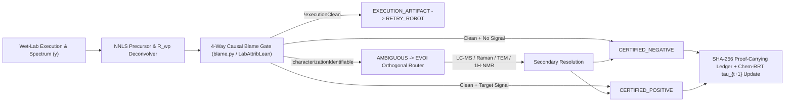

# `lab-attrib` — Post-Execution Causal Blame Calculus, Precursor Ghost-Peak Deconvolution & Proof-Carrying Negative Ledger

[](https://github.com/yaniguan/lab-attrib/actions/workflows/ci.yml)
[](LICENSE)
[](pyproject.toml)
[-purple.svg)](lean/LabAttribLean.lean)

> **Auto-Lab Layer**: `L4 · Post-Execution Diagnostic Gate & Certified Negative Ledger` in the [Robot AI Auto-Lab (`auto-lab`)](https://github.com/yaniguan/auto-lab) ecosystem ([Architecture & History](docs/ARCHITECTURE_AND_HISTORY.md)).

Existing self-driving laboratory (`SDL`) verifiers stop at **pre-execution** physical safety, leaving a critical epistemic blind spot **after** wet-lab execution completes:
1. **Analytical Ghost-Phase False Positives (`A-Lab` XRD controversy)**: Unreacted starting-precursor diffraction or optical peaks overlap putative novel target peaks, causing naive cosine/peak matchers to claim false discoveries.
2. **Negative-Result Epistemic Conflation (`Sakana AI Scientist-v2` debate & `La Agente Optima` sensor faults)**: Robotic dispense slip, acoustic cavitation, missed incubation windows, or unsealed plate evaporation yield zero target signal that naive pipelines write directly into scientific memory (`assayfold`, Bayesian optimization surrogates, RLVR reward tables) as "true biochemical negative results", poisoning downstream discovery.
3. **Uncertified Stepping-Stone Conformal Drift**: Expanding a conformal trust boundary via annular `Chem-RRT` stepping-stones ($\tau_t < d(x) \le (1 + \eta)\tau_t$) collapses if stepping-stone readouts themselves are physically corrupted or spectrally ambiguous.

`lab-attrib` resolves all three failure modes as a zero-dependency-core Python 3.10+ package (`src/lab_attrib/`) paired 1-to-1 with a standalone **Lean 4.36.0 formal verification package & CLI oracle** (`lean/LabAttribLean.lean` + `lean/Main.lean` + `lean/CheckAxioms.lean`: **30 machine-checked theorems**, **16 `#guard` compile-time checks**, **`--batch-tsv` differential oracle**, **`0 sorry`**, **`no custom axioms`**, **`0 warnings`**).

---

## Quick Start

```bash
pip install -e ".[dev]"

# 1. Run end-to-end diagnostic, NNLS deconvolution, EVOI routing & SHA-256 ledger showcase
lab-attrib demo

# 2. Attribute an individual post-execution telemetry JSON payload
lab-attrib attribute --json

# 3. Inspect the 9 open characterization/synthesis datasets & run the mineral XRD+Raman benchmark
lab-attrib datasets --benchmark-panel

# 4. Fetch & benchmark SHA-256-pinned real A-Lab GPSS, RRUFF/DARA, ROD Raman & MassSpecGym spectra
python scripts/benchmark_real_spectra.py
python scripts/fetch_open_spectra.py --verify-urls

# 5. Reproduce the 4-regime closed-loop attributed Chem-RRT benchmark (Delaney ESOL or AqSolDB)
lab-attrib benchmark --json

# 6. Run Python unit, real-spectra drift, wire contract & Lean parity tests
pytest -v

# 7. Machine-check all 30 Lean 4.36.0 theorems & audit #print axioms (0 sorry, no custom axioms)
cd lean && lake build && cd ..
python scripts/check_lean_axioms.py
```

---

## Canonical Auto-Lab Specification (`Object · Data · Model · Training · History · Unique Properties`)

### 1. Object
`lab-attrib` provides the post-execution default-deny verification gate between physical wet-lab / analytical instrumentation (`L1`–`L2`: [`stepbot`](https://github.com/yaniguan/stepbot), [`twinstep`](https://github.com/yaniguan/twinstep)) and persistent scientific memory (`L0`: [`assayfold`](https://github.com/yaniguan/assayfold)), closed-loop active learning (`L5`: [`lab-decide`](https://github.com/yaniguan/lab-decide)), and verifiable post-training (`L3`: [`labbench-posttrain`](https://github.com/yaniguan/labbench-posttrain)). While peer `L4` repositories [`lab-verify`](https://github.com/yaniguan/lab-verify) and [`lab-rehearsal`](https://github.com/yaniguan/lab-rehearsal) guard pre-execution SQL/proof/MCP calls and stateful deck trajectories, `lab-attrib` ensures that **no corrupted physical run is ever conflated with a negative scientific truth, and no unidentifiable precursor ghost peak is ever certified as a positive discovery**.



### 2. Data
- **Open Multi-Modal Characterization & Synthesis Registry (`src/lab_attrib/open_datasets.py`, `scripts/fetch_open_spectra.py`)**: Grounds `lab-attrib`'s NNLS deconvolver, Bayesian EVOI orthogonal router, and closed-loop `Chem-RRT` campaign in **9 live-verified open-source spectroscopy, crystallography, solid-state synthesis, and solubility datasets** across `XRD`, `Raman`, `LC-MS`, `1H-NMR`, and `Solubility` (fetched on-demand into gitignored `data/open_datasets/`):

| Dataset ID | Modality | SPDX License | Commercial OK | Records | Canonical Source & `lab-attrib` Integration |
|---|---|---|:---:|---:|---|
| `rruff_powder_xrd` | `XRD` | `Apache-2.0` | Yes | `5,842` | [AI4Spectro/rruff](https://huggingface.co/datasets/AI4Spectro/rruff) — RRUFF mineral powder XRD XY & DIF scans (`load_xy_diffractogram` -> `deconvolve_spectrum`) |
| `rruff_raman_zenodo` | `Raman` | `CC-BY-4.0` | Yes | `21,490` | [Zenodo 15742626](https://zenodo.org/records/15742626) — RRUFF/WURM/SLOPP-E mineral Raman spectra (`load_raman_spectrum` -> `evaluate_raman_orthogonal_readout`) |
| `cod_crystallography` | `XRD` | `CC0-1.0` | Yes | `530,000` | [Crystallography Open Database](https://www.crystallography.net/cod/) — Public-domain CIF & powder diffraction reference library |
| `mp20_crystal_phases` | `XRD` | `CC-BY-4.0` | Yes | `45,231` | [Materials Project MP-20](https://github.com/txie-93/cdvae/tree/main/data/mp_20) — Competing inorganic crystal polymorphs ($\le 20$ atoms/cell) |
| `alab_gpss_solid_state` | `XRD` | `CC-BY-4.0` | Yes | `352` | [CederGroupHub/alab_gpss_public](https://github.com/CederGroupHub/alab_gpss_public) ([Zenodo 19396297](https://zenodo.org/records/19396297)) — Autonomous halide spinel `.xrdml` scans, `LiCl` precursor fractions & $R_{\mathrm{wp}}$ (`load_alab_gpss_summary`) |
| `massspecgym_msms` | `LC-MS` | `MIT` | Yes | `231,104` | [roman-bushuiev/MassSpecGym](https://huggingface.co/datasets/roman-bushuiev/MassSpecGym) — NeurIPS 2024 tandem MS/MS MGF/TSV/JSON spectra (`load_massspecgym_spectra` -> `evaluate_msms_orthogonal_readout`) |
| `nmrshiftdb2_nmr` | `1H-NMR` | `OPL-1.0` | No | `70,029` | [NMRShiftDB2](https://nmrshiftdb.nmr.uni-koeln.de/) — Measured 1H/13C NMR reference shifts (`commercial_use_ok=False` under Open Content License) |
| `bmrb_metabolomics_nmr` | `1H-NMR` | `CC0-1.0` | Yes | `5,200` | [BMRB](https://bmrb.io/) — Public-domain small-molecule 1H/13C NMR spectra (`commercial_use_ok=True` companion to `NMRShiftDB2`) |
| `aqsoldb_solubility` | `Solubility` | `CC-BY-4.0` | Yes | `9,982` | [AqSolDB](https://huggingface.co/datasets/maomlab/AqSolDB) ([DOI 10.7910/DVN/OVHAW8](https://dataverse.harvard.edu/api/access/datafile/3407241)) — Curated aqueous $\log S$ & 2D descriptors (`load_aqsoldb_csv` -> `run_attributed_frontier_benchmark`) |

- **Bundled Zero-Network Oxide/Halide/Mineral Reference Panel (`11` phases)**: Ships curated $\mathrm{Cu\,K\alpha}$ Bragg $2\theta$ peak tables paired with Raman vibrational shifts ($\mathrm{cm}^{-1}$) for `LiCl`, `MgCl2`, `Li2MgCl4`, cubic/tetragonal `ZrO2`, `Y2O3`, `TiO2` (anatase), `BaCO3` (witherite), `BaTiO3`, `Calcite` (`R050048`), and `Alpha-Quartz` (`COD-9009666`), enabling offline multiphase ghost-peak deconvolution and Raman/TEM orthogonal routing (`lab-attrib datasets --benchmark-panel`).
- **Empirical Closed-Loop Frontier Benchmark (`Delaney ESOL`, `1,128` molecules & `AqSolDB`, `9,982` molecules)**: Evaluates 6 physicochemical descriptors (`Minimum Degree`, `Molecular Weight`, `Number of H-Bond Donors`, `Number of Rings`, `Number of Rotatable Bonds`, `Polar Surface Area`) and measured aqueous log solubility ($\log S$). Partitions low-MW fragments (`Rings <= 2`, `MW <= 220 Da`, `657` molecules on ESOL) into seed training/calibration and explores `471` higher-MW and multi-ring (`Rings >= 3`, up to `8` rings) frontier candidates (`44` true soluble multi-ring hits with $\log S \ge -3.50$). Includes an automatic deterministic `720`-molecule synthetic physicochemical fallback (`build_synthetic_esol_pool`) when external CSV files are absent.
- **Multiphase Spectral & Fault Telemetry**: Synthetic multi-peak diffraction/optical profiles (`build_gaussian_spectrum`) covering precursor ghost-peak shadowing (`A-Lab` failure mode), third-party polymorph $R_{\mathrm{wp}}$ anomalies, zero-baseline buffer controls, and robotic aspiration/dispense/incubation/seal faults (`22%` hardware fault rate + `18%` precursor ghost-peak rate in closed-loop stress benchmarks).

### 3. Model
`lab-attrib` is purely algorithmic, symbolic, and optimization-grounded (training **no neural weights**):
1. **4-Way Blame Calculus (`src/lab_attrib/blame.py`, `lean/LabAttribLean.lean`)**: Exact integer-permille predicates `execution_clean` (`dispense_error <= 50`, clean aspiration, clean incubation window, intact seal, passed positive & blank controls) and `characterization_identifiable` (`detector_calibrated`, `precursor_overlap <= 150`, `spectral_residual <= 100`, `snr_tenths >= 30`) partitioning every run into `EXECUTION_ARTIFACT`, `AMBIGUOUS_CHARACTERIZATION`, `CERTIFIED_NEGATIVE`, or `CERTIFIED_POSITIVE`.
2. **Shift-Tolerant Pseudo-Voigt `L1-NNLS` Deconvolver & MS/MS Spectral Entropy Engine (`src/lab_attrib/deconvolution.py`, `src/lab_attrib/xrd_deconvolve.py`)**: Upgrades multiphase phase attribution beyond rigid fixed-grid Gaussian NNLS with coarse-grid + continuous Golden-Section `2-theta` zero-point & Vegard solid-solution lattice alignment (`+-0.35 deg`), Pseudo-Voigt Gaussian/Lorentzian peak broadening, Bernstein polynomial amorphous background subtraction, and weighted sparsity-regularized `elastic_nnls` (`L1/L2-NNLS` to KKT tolerance `<= 1e-10` in both NumPy and pure-Python stdlib, `< 1e-8` parity). For tandem MS/MS (`MassSpecGym`), pairs greedy fragment cosine with unweighted and dynamically weighted **Spectral Entropy Similarity** (Li et al., *Nature Methods* 2021) plus convex two-component mixture entropy maximization to quarantine near-isobaric co-eluting chimeras.
3. **Bayesian EVOI Orthogonal Router (`src/lab_attrib/orthogonal_router.py`)**: Ranks secondary modalities (`Raman`, `LC-MS`, `1H-NMR`, `TEM`) by Net Expected Value of Information subject to sample volume (`uL`) and phase compatibility.
4. **SHA-256 Proof-Carrying Ledger (`src/lab_attrib/ledger.py`)**: Append-only cryptographic chain binding sample descriptors, raw telemetry, optional orthogonal readout, `AttributionOutcome`, and `LabAttribLean` theorem tags, with full chain re-verification (`verify_chain()`).

#### Measured Real vs. Controlled-Synthetic Spectroscopy Benchmark (`results/real_spectra_benchmark.json`)
Evaluated across **51 SHA-256-pinned public experimental spectroscopy & crystal-structure files** (`scripts/benchmark_real_spectra.py`, gitignored `data/open_datasets/real_benchmark/`) spanning Ceder Group `A-Lab GPSS` PANalytical `.xrdml` scans + `352`-run summary, `RRUFF` `.dif`/`.xy` & `DARA` multi-mineral `.xrdml`/`.xy` diffractograms, `RRUFF/ROD` `.rod` + `JCAMP-DX` Raman polymorphs, and `2,417` `MassSpecGym` Orbitrap/Q-TOF tandem MS/MS spectra (`182` cross-scan queries + `24` near-isobaric chimeras), alongside a controlled `synthetic_ablation` shift/broadening sweep:

<!-- BEGIN REAL_VS_SYNTHETIC_SPECTRA_TABLE -->
| Suite ID | Modality & Corpus | `data_source` | Eval Cases | Naive FDR | Rigid NNLS / Cosine FDR | Frontier `L1-NNLS` / Entropy FDR | Baseline Recall | Frontier Recall | Baseline `Rwp` / Top-1 | Frontier `Rwp` / Top-1 |
|---|---|---|---:|---:|---:|---:|---:|---:|---:|---:|
| `alab_gpss_xrd` | XRD (A-Lab GPSS .xrdml) | `real_experimental` | `8` | `50.00%` | `0.00%` | **`0.00%`** | `0.00%` | **`75.00%`** | `641.2 permille` | **`258.0 permille`** |
| `rruff_dara_powder_xrd` | XRD (RRUFF .dif/.xy + DARA .xrdml) | `real_experimental` | `8` | `50.00%` | `48.28%` | **`6.25%`** | `100.00%` | **`100.00%`** | `649.4 permille` | **`199.6 permille`** |
| `rruff_rod_raman` | Raman (RRUFF/ROD .rod + JCAMP-DX) | `real_experimental` | `12` | `50.00%` | `40.62%` | **`0.00%`** | `100.00%` | **`100.00%`** | `309.5 permille` | **`13.2 permille`** |
| `massspecgym_msms` | LC-MS/MS (MassSpecGym) | `real_experimental` | `206` | `35.20%` | `28.68%` | **`12.60%`** | `51.27%` | **`66.47%`** | `69.23% Top-1` | **`82.42% Top-1`** |
| `synthetic_controlled_ablation` | XRD Controlled Shift+Voigt Sweep | `synthetic_ablation` | `12` | `0.00%` | `50.00%` | **`0.00%`** | `100.00%` | **`100.00%`** | `739.6 permille` | **`71.1 permille`** |
<!-- END REAL_VS_SYNTHETIC_SPECTRA_TABLE -->

#### Measured 4-Regime Closed-Loop Benchmark (`benchmarks/results/lab_attrib_benchmark.json`)
Averaged over `5` seeds (`11, 23, 37, 53, 71`) $\times$ `9` rounds $\times$ `20` assays/round on Delaney ESOL (`1,128` molecules, nominal `90.0%` conformal target):

| Regime | Verified Multi-Ring Hits | False Positive Hits | FDR (`%`) | Poisoned Memory Entries | 90% Conformal Coverage (`%`) | Frontier Surrogate RMSE | Certified Ledger Entries |
|---|---:|---:|---:|---:|---:|---:|---:|
| `naive_raw_writeback` | `21.40` | `15.00` | `40.22%` | `66.20` | `66.80%` | `2.0715` | `0.00` |
| `pre_gate_only_static` | `0.00` | `0.00` | `0.00%` | `15.00` | `78.33%` | `4.4604` | `0.00` |
| `unattributed_frontier_probes` | `22.60` | `14.00` | `37.91%` | `64.20` | `76.01%` | `1.3852` | `0.00` |
| **`lab_attrib_full_closed_loop`** | **`31.00`** | **`0.00`** | **`0.00%`** | **`0.00`** | **`96.39%`** | **`1.2286`** | **`177.60`** |

### 4. Training
No parametric deep learning weights are trained. Surrogate active-learning loops in `attributed_frontier.py` solve closed-form quadratic ridge regression (`13` basis terms) paired with finite-sample split-conformal residual quantiles. Downstream, `CertifiedLedger.export_training_pairs()` acts as a cryptographically verified data firewall supplying unpoisoned positive and negative labels to BO surrogates and RLVR post-training (`labbench-posttrain`).

### 5. History
Created in `2026` by Yani Guan as the **15th core repository** in the [Robot AI Auto-Lab](https://github.com/yaniguan/auto-lab) architecture to close the post-execution causal attribution gap exposed by recent autonomous materials (`A-Lab`) and AI-scientist (`AI Scientist-v2`) debates. See [`docs/ARCHITECTURE_AND_HISTORY.md`](docs/ARCHITECTURE_AND_HISTORY.md) for the full commit and design chronicle.

### 6. Unique Properties
- **30 Machine-Checked Lean 4.36.0 Theorems (`0 sorry`, `no custom axioms`)**: Proves 4-way exhaustiveness (`outcome_exhaustive_four_way`), memory-poisoning immunity (`corrupted_run_never_poisons_memory`), `A-Lab` ghost-peak blocking (`unidentifiable_spectrum_never_certified`), certified negative/positive soundness (`certified_negative_sound`, `certified_positive_sound`), non-laundering secondary resolution (`orthogonal_cannot_launder_corrupted_execution`), attributed annular `Chem-RRT` expansion (`valid_tau_expansion_requires_certified_micro_probe`), and inductive hash-chain validity (`appendCertified_preserves_ledger_validity`, `ledger_entries_all_scientifically_admissible`), verified in CI via `#print axioms` (`lean/CheckAxioms.lean`, `scripts/check_lean_axioms.py`).
- **Zero-Dependency Stdlib Core**: `src/lab_attrib/` requires zero third-party packages at runtime while seamlessly utilizing `numpy` acceleration when installed.
- **Proof-Carrying Negative Results**: Elevates negative results to first-class, hash-chained scientific assets backed by verified robotic execution and statistical detection power.

---

## 15-Repository Auto-Lab Wire Contract (`autolab-wire/v1`)

`autolab_wire.py` (`REPO_ID = "lab-attrib"`, `LAYER = "L4"`, `SCHEMA_VERSION = "autolab-wire/v1"`) connects `lab-attrib` directly into the 15-repository [Robot AI Auto-Lab](https://github.com/yaniguan/auto-lab) closed-loop packet bus via `process_packet(packet: dict) -> dict`:

- **Wire Topology**: `stepbot, lab-feet -> lab-attrib -> twinstep, labbench-posttrain, lab-decide`
  - **Upstream Bench Execution (`L1` / `L0`)**: Consumes execution receipts and quantized bench sensor telemetry (`edge_runtime`: `dispense_error_permille`, `aspiration_clean`, `incubation_window_clean`, `seal_intact`) from [`stepbot`](https://github.com/yaniguan/stepbot) and [`lab-feet`](https://github.com/yaniguan/lab-feet), plus optional 1D multiphase diffraction/optical profiles (`xrd_mixture`: `observed`, `target_basis`, `precursor_bases`).
  - **Post-Execution Gate (`L4`)**: Fails closed (`L4_ATTRIB_SCHEMA_REJECT`) on malformed, non-boolean, non-integer, negative, or non-finite telemetry fields; runs live NNLS / Shift-Tolerant Pseudo-Voigt `L1-NNLS` deconvolution (`deconvolve_spectrum`), evaluates 4-way `LabAttribLean` causal blame (`diagnose_assay`), invokes Bayesian EVOI secondary routing (`route_orthogonal_assay` -> `"Raman"` / `"LC-MS"` / `"TEM"` / `"1H-NMR"`) on `AMBIGUOUS_CHARACTERIZATION`, appends certified runs to a SHA-256 `CertifiedLedger` (`certified_ledger_entries`), and quarantines uncertified runs with `halted = True`, `halt_reason = "L4_ATTRIB_QUARANTINE"` (`trace` status `"QUARANTINE"`, bottom-up invariant `"corrupted_run_never_poisons_memory & unidentifiable_spectrum_never_certified"`).
  - **Downstream Learning & Boundary Recalibration (`L3` / `L6` / `L0`)**: Feeds verified trajectories into [`twinstep`](https://github.com/yaniguan/twinstep) (error-twin DAG synthesis, paired with [`labfill`](https://github.com/yaniguan/labfill)), [`labbench-posttrain`](https://github.com/yaniguan/labbench-posttrain) (multiplicative anti-hack RLVR zeroing reward on `L4_ATTRIB_QUARANTINE` / `L4_ATTRIB_SCHEMA_REJECT` while admitting `admit_to_memory=True` rollouts), [`lab-decide`](https://github.com/yaniguan/lab-decide) (expanding finite-sample split-conformal calibration counts and trust thresholds strictly from `certified_ledger_entries`), and [`assayfold`](https://github.com/yaniguan/assayfold) alongside sibling stack nodes (`lab-ears`, `lab-ask-why`, `lab-automation-atlas`, `buy-or-make`, `labshift`, `lab-rehearsal`, `lab-verify`, `lab-hands`).

---

## Repository Structure

```text
lab-attrib/
├── .github/workflows/ci.yml              # Matrix Python (3.10, 3.11, 3.12) + Lean 4.36.0 + #print axioms
├── autolab_wire.py                       # Fail-closed 15-repo Auto-Lab wire node (`autolab-wire/v1`, Layer L4)
├── benchmarks/results/                   # Measured 4-regime closed-loop ESOL benchmark JSON
├── results/real_spectra_benchmark.json   # SHA-256-pinned real vs. synthetic spectroscopy benchmark JSON
├── community_extensions/                 # Hub parity entrypoint (`run_benchmark()`)
├── docs/ARCHITECTURE_AND_HISTORY.md      # Full 6-section Auto-Lab architectural specification
├── lean/
│   ├── LabAttribLean.lean                # 30 formal theorems + 16 #guard checks (0 sorry, no custom axioms)
│   ├── CheckAxioms.lean                  # Kernel `#print axioms` audit across all 30 theorems
│   ├── Main.lean                         # Compiled `lab-attrib-lean --batch-tsv` differential CLI
│   ├── lakefile.toml                     # Lean 4 library & executable configuration
│   ├── lean-toolchain                    # Pinned leanprover/lean4:v4.36.0
│   └── README.md                         # Formal theorem inventory
├── scripts/
│   ├── benchmark_real_spectra.py         # Real A-Lab GPSS / RRUFF / ROD Raman / MassSpecGym benchmark
│   ├── check_lean_axioms.py              # CI verifier for `#print axioms` & `no custom axioms`
│   └── fetch_open_spectra.py             # On-demand spectral/solubility downloader & live URL verifier
├── src/lab_attrib/
│   ├── blame.py                          # Exact Python mirror of 4-way blame & stepping-stone gates
│   ├── deconvolution.py                  # Pseudo-Voigt L1-NNLS (`elastic_nnls`), Golden-Section shift & MS/MS entropy
│   ├── xrd_deconvolve.py                 # Weighted active-set NNLS deconvolver + shift/baseline models
│   ├── orthogonal_router.py              # Bayesian EVOI secondary assay router (Raman/LC-MS/NMR/TEM)
│   ├── ledger.py                         # SHA-256 + Merkle + HMAC/Ed25519 CertifiedLedger & WAL
│   ├── attributed_frontier.py            # 4-regime closed-loop Chem-RRT campaign on ESOL & AqSolDB
│   ├── open_datasets.py                  # 9-dataset open registry, CIF/DIF/ROD/JCAMP parsers & mineral panel
│   └── cli.py                            # `lab-attrib` CLI (`demo`, `attribute`, `benchmark`, `datasets`)
└── tests/                                # Unit, frontier deconvolution, README drift, wire & Lean parity tests
```

---

## Scientific References & Motivation
1. Szymanski, N. J. et al. *An autonomous laboratory for the accelerated synthesis of novel materials* (`A-Lab`), **Nature** 624, 86–91 (2023); Ceder Group `alab_gpss_public` & Zenodo DOI `10.5281/zenodo.19396297` (2026).
2. Cheetham, A. K. & Seshadri, R. *Artificial intelligence driving materials discovery? Perspective on the article: An autonomous laboratory for the accelerated synthesis of novel materials*, **Chemistry of Materials** 36, 3490–3495 (2024) — documenting precursor diffraction peak overlap and phase-identification pitfalls in autonomous XRD pipelines.
3. Li, Y. et al. *Spectral entropy outperforms MS/MS dot product similarity for small-molecule compound identification*, **Nature Methods** 18, 1524–1531 (2021) — unweighted and low-entropy dynamically weighted MS/MS spectral entropy similarity.
4. Lawson, C. L. & Hanson, R. J. *Solving Least Squares Problems*, **SIAM** (1995) — active-set and non-negative least squares (`NNLS`) foundations.
5. Lafuente, B. et al. *The power of databases: The RRUFF project*, in *Highlights in Mineralogical Crystallography*, **De Gruyter**, 1–30 (2015); Grazulis, S. et al. *Crystallography Open Database (`COD`)*, **Nucleic Acids Research** 40, D420–D427 (2012).
6. Bushuiev, R. et al. *MassSpecGym: A benchmark for the discovery and identification of molecules*, **NeurIPS** (2024); Sorkun, M. C., Khetan, A. & Er, S. *AqSolDB, a curated reference set of aqueous solubility and 2D descriptors for a diverse set of compounds*, **Scientific Data** 6, 143 (2019).
7. Delaney, J. S. *ESOL: Estimating aqueous solubility directly from molecular structure*, **Journal of Chemical Information and Computer Sciences** 44, 1000–1005 (2004).
8. Vovk, V., Gammerman, A. & Shafer, G. *Algorithmic Learning in a Random World*, **Springer** (2005); Angelopoulos, A. N. & Bates, S. *Conformal prediction: A gentle introduction*, **Foundations and Trends in Machine Learning** (2023).

## License
MIT License — Copyright (c) 2026 Yani Guan. See [`LICENSE`](LICENSE).
