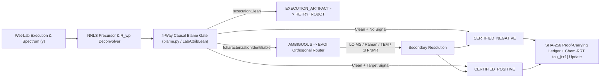

# `lab-attrib` — Post-Execution Causal Blame Calculus, Precursor Ghost-Peak Deconvolution & Proof-Carrying Negative Ledger

[](https://github.com/yaniguan/lab-attrib/actions/workflows/ci.yml)
[](LICENSE)
[](pyproject.toml)
[-purple.svg)](lean/LabAttribLean.lean)

> **Auto-Lab Layer**: `L4 · Post-Execution Diagnostic Gate & Certified Negative Ledger` in the [Robot AI Auto-Lab (`auto-lab`)](https://github.com/yaniguan/auto-lab) ecosystem ([Architecture & History](docs/ARCHITECTURE_AND_HISTORY.md)).

Existing self-driving laboratory (`SDL`) verifiers stop at **pre-execution** physical safety, leaving a critical epistemic blind spot **after** wet-lab execution completes:
1. **Analytical Ghost-Phase False Positives (`A-Lab` XRD controversy)**: Unreacted starting-precursor diffraction or optical peaks overlap putative novel target peaks, causing naive cosine/peak matchers to claim false discoveries.
2. **Negative-Result Epistemic Conflation (`Sakana AI Scientist-v2` debate & `La Agente Optima` sensor faults)**: Robotic dispense slip, acoustic cavitation, missed incubation windows, or unsealed plate evaporation yield zero target signal that naive pipelines write directly into scientific memory (`assayfold`, Bayesian optimization surrogates, RLVR reward tables) as "true biochemical negative results", poisoning downstream discovery.
3. **Uncertified Stepping-Stone Conformal Drift**: Expanding a conformal trust boundary via annular `Chem-RRT` stepping-stones ($\tau_t < d(x) \le (1 + \eta)\tau_t$) collapses if stepping-stone readouts themselves are physically corrupted or spectrally ambiguous.

`lab-attrib` resolves all three failure modes as a zero-dependency-core Python 3.10+ package (`src/lab_attrib/`) paired 1-to-1 with a standalone **Lean 4.36.0 formal verification package & CLI oracle** (`lean/LabAttribLean.lean` + `lean/Main.lean`: **29 machine-checked theorems**, **16 `#guard` compile-time checks**, **`--batch-tsv` differential oracle**, **`0 sorry`**, **`0 axiom`**, **`0 warnings`**).

---

## Quick Start

```bash
pip install -e ".[dev]"

# 1. Run end-to-end diagnostic, NNLS deconvolution, EVOI routing & SHA-256 ledger showcase
lab-attrib demo

# 2. Attribute an individual post-execution telemetry JSON payload
lab-attrib attribute --json

# 3. Reproduce the 4-regime closed-loop attributed Chem-RRT benchmark
lab-attrib benchmark --json

# 4. Run Python unit, wire contract & Lean parity tests (67 tests)
pytest -v

# 5. Machine-check all 29 Lean 4.36.0 theorems & build lab-attrib-lean CLI (0 sorry, 0 axiom, 0 warnings)
cd lean && lake build
```

---

## Canonical Auto-Lab Specification (`Object · Data · Model · Training · History · Unique Properties`)

### 1. Object
`lab-attrib` provides the post-execution default-deny verification gate between physical wet-lab / analytical instrumentation (`L1`–`L2`: [`stepbot`](https://github.com/yaniguan/stepbot), [`twinstep`](https://github.com/yaniguan/twinstep)) and persistent scientific memory (`L0`: [`assayfold`](https://github.com/yaniguan/assayfold)), closed-loop active learning (`L5`: [`lab-decide`](https://github.com/yaniguan/lab-decide)), and verifiable post-training (`L3`: [`labbench-posttrain`](https://github.com/yaniguan/labbench-posttrain)). While peer `L4` repositories [`lab-verify`](https://github.com/yaniguan/lab-verify) and [`lab-rehearsal`](https://github.com/yaniguan/lab-rehearsal) guard pre-execution SQL/proof/MCP calls and stateful deck trajectories, `lab-attrib` ensures that **no corrupted physical run is ever conflated with a negative scientific truth, and no unidentifiable precursor ghost peak is ever certified as a positive discovery**.



### 2. Data
- **Empirical Closed-Loop Frontier Benchmark (`Delaney ESOL`, `1,128` molecules)**: Evaluates 6 physicochemical descriptors (`Minimum Degree`, `Molecular Weight`, `Number of H-Bond Donors`, `Number of Rings`, `Number of Rotatable Bonds`, `Polar Surface Area`) and measured aqueous log solubility ($\log S$). Partitions low-MW fragments (`Rings <= 2`, `MW <= 220 Da`, `657` molecules) into seed training/calibration and explores `471` higher-MW and multi-ring (`Rings >= 3`, up to `8` rings) frontier candidates (`44` true soluble multi-ring hits with $\log S \ge -3.50$). Includes an automatic deterministic `720`-molecule synthetic physicochemical fallback (`build_synthetic_esol_pool`) when external CSV files are absent.
- **Multiphase Spectral & Fault Telemetry**: Synthetic multi-peak diffraction/optical profiles (`build_gaussian_spectrum`) covering precursor ghost-peak shadowing (`A-Lab` failure mode), third-party polymorph $R_{\mathrm{wp}}$ anomalies, zero-baseline buffer controls, and robotic aspiration/dispense/incubation/seal faults (`22%` hardware fault rate + `18%` precursor ghost-peak rate in closed-loop stress benchmarks).

### 3. Model
`lab-attrib` is purely algorithmic, symbolic, and optimization-grounded (training **no neural weights**):
1. **4-Way Blame Calculus (`src/lab_attrib/blame.py`, `lean/LabAttribLean.lean`)**: Exact integer-permille predicates `execution_clean` (`dispense_error <= 50`, clean aspiration, clean incubation window, intact seal, passed positive & blank controls) and `characterization_identifiable` (`detector_calibrated`, `precursor_overlap <= 150`, `spectral_residual <= 100`, `snr_tenths >= 30`) partitioning every run into `EXECUTION_ARTIFACT`, `AMBIGUOUS_CHARACTERIZATION`, `CERTIFIED_NEGATIVE`, or `CERTIFIED_POSITIVE`.
2. **Projected Coordinate Descent NNLS Deconvolver (`src/lab_attrib/xrd_deconvolve.py`)**: Decomposes $y \approx \sum_{j=1}^K c_j p_j + \beta s_{\mathrm{target}}$ ($c_j \ge 0, \beta \ge 0$) to KKT tolerance $10^{-10}$ using either `numpy` or a zero-dependency pure-Python stdlib solver (`< 1e-8` parity), emitting `precursor_overlap_permille` and `spectral_residual_permille` ($R_{\mathrm{wp}}$).
3. **Bayesian EVOI Orthogonal Router (`src/lab_attrib/orthogonal_router.py`)**: Ranks secondary modalities (`Raman`, `LC-MS`, `1H-NMR`, `TEM`) by Net Expected Value of Information subject to sample volume (`uL`) and phase compatibility.
4. **SHA-256 Proof-Carrying Ledger (`src/lab_attrib/ledger.py`)**: Append-only cryptographic chain binding sample descriptors, raw telemetry, optional orthogonal readout, `AttributionOutcome`, and `LabAttribLean` theorem tags, with full chain re-verification (`verify_chain()`).

#### Measured 4-Regime Closed-Loop Benchmark (`benchmarks/results/lab_attrib_benchmark.json`)
Averaged over `5` seeds (`11, 23, 37, 53, 71`) $\times$ `9` rounds $\times$ `20` assays/round on Delaney ESOL (`1,128` molecules, nominal `90.0%` conformal target):

| Regime | Verified Multi-Ring Hits | False Positive Hits | FDR (`%`) | Poisoned Memory Entries | 90% Conformal Coverage (`%`) | Frontier Surrogate RMSE | Certified Ledger Entries |
|---|---:|---:|---:|---:|---:|---:|---:|
| `naive_raw_writeback` | `21.40` | `15.00` | `40.22%` | `66.20` | `66.80%` | `2.0715` | `0.00` |
| `pre_gate_only_static` | `0.00` | `0.00` | `0.00%` | `15.00` | `78.33%` | `4.4604` | `0.00` |
| `unattributed_frontier_probes` | `22.60` | `14.00` | `37.91%` | `64.20` | `76.01%` | `1.3852` | `0.00` |
| **`lab_attrib_full_closed_loop`** | **`31.00`** | **`0.00`** | **`0.00%`** | **`0.00`** | **`96.39%`** | **`1.2286`** | **`177.60`** |

### 4. Training
No parametric deep learning weights are trained. Surrogate active-learning loops in `attributed_frontier.py` solve closed-form quadratic ridge regression (`13` basis terms) paired with finite-sample split-conformal residual quantiles. Downstream, `CertifiedLedger.export_training_pairs()` acts as a cryptographically verified data firewall supplying unpoisoned positive and negative labels to BO surrogates and RLVR post-training (`labbench-posttrain`).

### 5. History
Created in `2026` by Yani Guan as the **15th core repository** in the [Robot AI Auto-Lab](https://github.com/yaniguan/auto-lab) architecture to close the post-execution causal attribution gap exposed by recent autonomous materials (`A-Lab`) and AI-scientist (`AI Scientist-v2`) debates. See [`docs/ARCHITECTURE_AND_HISTORY.md`](docs/ARCHITECTURE_AND_HISTORY.md) for the full commit and design chronicle.

### 6. Unique Properties
- **25 Machine-Checked Lean 4.36.0 Theorems (`0 sorry`, `0 axiom`)**: Proves 4-way exhaustiveness (`outcome_exhaustive_four_way`), memory-poisoning immunity (`corrupted_run_never_poisons_memory`), `A-Lab` ghost-peak blocking (`unidentifiable_spectrum_never_certified`), certified negative/positive soundness (`certified_negative_sound`, `certified_positive_sound`), non-laundering secondary resolution (`orthogonal_cannot_launder_corrupted_execution`), attributed annular `Chem-RRT` expansion (`valid_tau_expansion_requires_certified_micro_probe`), and inductive hash-chain validity (`appendCertified_preserves_ledger_validity`, `ledger_entries_all_scientifically_admissible`).
- **Zero-Dependency Stdlib Core**: `src/lab_attrib/` requires zero third-party packages at runtime while seamlessly utilizing `numpy` acceleration when installed.
- **Proof-Carrying Negative Results**: Elevates negative results to first-class, hash-chained scientific assets backed by verified robotic execution and statistical detection power.

---

## 15-Repository Auto-Lab Wire Contract (`autolab-wire/v1`)

`autolab_wire.py` (`REPO_ID = "lab-attrib"`, `LAYER = "L4"`, `SCHEMA_VERSION = "autolab-wire/v1"`) connects `lab-attrib` directly into the 15-repository [Robot AI Auto-Lab](https://github.com/yaniguan/auto-lab) closed-loop packet bus via `process_packet(packet: dict) -> dict`:

- **Wire Topology**: `stepbot, lab-feet -> lab-attrib -> twinstep, labbench-posttrain, lab-decide`
  - **Upstream Bench Execution (`L1` / `L0`)**: Consumes execution receipts and quantized bench sensor telemetry (`edge_runtime`: `dispense_error_permille`, `aspiration_clean`, `incubation_window_clean`, `seal_intact`) from [`stepbot`](https://github.com/yaniguan/stepbot) and [`lab-feet`](https://github.com/yaniguan/lab-feet), plus optional 1D multiphase diffraction/optical profiles (`xrd_mixture`: `observed`, `target_basis`, `precursor_bases`).
  - **Post-Execution Gate (`L4`)**: Runs live Projected Coordinate Descent NNLS deconvolution (`deconvolve_spectrum`), evaluates 4-way `LabAttribLean` causal blame (`diagnose_assay`), invokes Bayesian EVOI secondary routing (`route_orthogonal_assay` -> `"Raman"` / `"LC-MS"` / `"TEM"` / `"1H-NMR"`) on `AMBIGUOUS_CHARACTERIZATION`, appends certified runs to a SHA-256 `CertifiedLedger` (`certified_ledger_entries`), and quarantines uncertified runs with `halted = True`, `halt_reason = "L4_ATTRIB_QUARANTINE"` (`trace` status `"QUARANTINE"`, bottom-up invariant `"corrupted_run_never_poisons_memory & unidentifiable_spectrum_never_certified"`).
  - **Downstream Learning & Boundary Recalibration (`L3` / `L6` / `L0`)**: Feeds verified trajectories into [`twinstep`](https://github.com/yaniguan/twinstep) (error-twin DAG synthesis, paired with [`labfill`](https://github.com/yaniguan/labfill)), [`labbench-posttrain`](https://github.com/yaniguan/labbench-posttrain) (multiplicative anti-hack RLVR zeroing reward on `L4_ATTRIB_QUARANTINE` while admitting `admit_to_memory=True` rollouts), [`lab-decide`](https://github.com/yaniguan/lab-decide) (expanding finite-sample split-conformal calibration counts and trust thresholds strictly from `certified_ledger_entries`), and [`assayfold`](https://github.com/yaniguan/assayfold) alongside sibling stack nodes (`lab-ears`, `lab-ask-why`, `lab-automation-atlas`, `buy-or-make`, `labshift`, `lab-rehearsal`, `lab-verify`, `lab-hands`).

---

## Repository Structure

```text
lab-attrib/
├── .github/workflows/ci.yml              # Matrix Python (3.10, 3.11, 3.12) + Lean 4.36.0 lake build
├── autolab_wire.py                       # 15-repo Auto-Lab wire node (`autolab-wire/v1`, Layer L4)
├── benchmarks/results/                   # Measured 4-regime closed-loop ESOL benchmark JSON
├── community_extensions/                 # Hub parity entrypoint (`run_benchmark()`)
├── docs/ARCHITECTURE_AND_HISTORY.md      # Full 6-section Auto-Lab architectural specification
├── lean/
│   ├── LabAttribLean.lean                # 29 formal theorems + 16 #guard checks (0 sorry, 0 axiom)
│   ├── Main.lean                         # Compiled `lab-attrib-lean --batch-tsv` differential CLI
│   ├── lakefile.toml                     # Lean 4 library & executable configuration
│   ├── lean-toolchain                    # Pinned leanprover/lean4:v4.36.0
│   └── README.md                         # Formal theorem inventory
├── src/lab_attrib/
│   ├── blame.py                          # Exact Python mirror of 4-way blame & stepping-stone gates
│   ├── xrd_deconvolve.py                 # Weighted active-set NNLS deconvolver + shift/baseline models
│   ├── orthogonal_router.py              # Bayesian EVOI secondary assay router (Raman/LC-MS/NMR/TEM)
│   ├── ledger.py                         # SHA-256 + Merkle + HMAC/Ed25519 CertifiedLedger & WAL
│   ├── attributed_frontier.py            # 4-regime closed-loop Chem-RRT campaign on Delaney ESOL
│   └── cli.py                            # `lab-attrib` CLI (`demo`, `attribute`, `benchmark`)
└── tests/                                # 67 unit, wire-contract, numerical parity & zero-CJK tests
```

---

## Scientific References & Motivation
1. Szymanski, N. J. et al. *An autonomous laboratory for the accelerated synthesis of novel materials* (`A-Lab`), **Nature** 624, 86–91 (2023).
2. Cheetham, A. K. & Seshadri, R. *Artificial intelligence driving materials discovery? Perspective on the article: An autonomous laboratory for the accelerated synthesis of novel materials*, **Chemistry of Materials** 36, 3490–3495 (2024) — documenting precursor diffraction peak overlap and phase-identification pitfalls in autonomous XRD pipelines.
3. Lawson, C. L. & Hanson, R. J. *Solving Least Squares Problems*, **SIAM** (1995) — active-set and non-negative least squares (`NNLS`) foundations.
4. Delaney, J. S. *ESOL: Estimating aqueous solubility directly from molecular structure*, **Journal of Chemical Information and Computer Sciences** 44, 1000–1005 (2004).
5. Vovk, V., Gammerman, A. & Shafer, G. *Algorithmic Learning in a Random World*, **Springer** (2005); Angelopoulos, A. N. & Bates, S. *Conformal prediction: A gentle introduction*, **Foundations and Trends in Machine Learning** (2023).

## License
MIT License — Copyright (c) 2026 Yani Guan. See [`LICENSE`](LICENSE).
