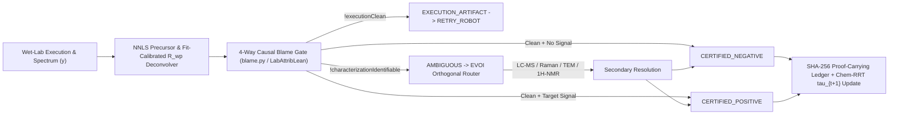

# `lab-attrib` — Post-Execution Causal Blame Calculus, Precursor Ghost-Peak Deconvolution & Proof-Carrying Negative Ledger

[](https://github.com/yaniguan/lab-attrib/actions/workflows/ci.yml)
[](LICENSE)
[](pyproject.toml)
[-purple.svg)](lean/LabAttribLean.lean)

> **Auto-Lab Layer**: `L4 · Post-Execution Diagnostic Gate & Certified Negative Ledger` in the [Robot AI Auto-Lab (`auto-lab`)](https://github.com/yaniguan/auto-lab) ecosystem ([Architecture & History](docs/ARCHITECTURE_AND_HISTORY.md)).

Existing self-driving laboratory (`SDL`) verifiers stop at **pre-execution** physical safety, leaving a critical epistemic blind spot **after** wet-lab execution completes:
1. **Analytical Ghost-Phase False Positives (`A-Lab` XRD controversy)**: Unreacted starting-precursor diffraction or optical peaks overlap putative novel target peaks, causing naive cosine/peak matchers to claim false discoveries.
2. **Negative-Result Epistemic Conflation (`Sakana AI Scientist-v2` debate & `La Agente Optima` sensor faults)**: Robotic dispense slip, acoustic cavitation, missed incubation windows, or unsealed plate evaporation yield zero target signal that naive pipelines write directly into scientific memory (`assayfold`, Bayesian optimization surrogates, RLVR reward tables) as "true biochemical negative results", poisoning downstream discovery.
3. **Uncertified Stepping-Stone Conformal Drift**: Expanding a conformal trust boundary via annular `Chem-RRT` stepping-stones ($\tau_t < d(x) \le (1 + \eta)\tau_t$) collapses if stepping-stone readouts themselves are physically corrupted or spectrally ambiguous.

`lab-attrib` resolves all three failure modes as a zero-dependency-core Python 3.10+ package (`src/lab_attrib/`) paired 1-to-1 with a standalone **Lean 4.36.0 formal verification package & CLI oracle** (`lean/LabAttribLean.lean` + `lean/Main.lean` + `lean/CheckAxioms.lean`: **31 machine-checked theorems**, **17 `#guard` compile-time checks**, **`--batch-tsv` differential oracle**, **`0 sorry`**, **`no custom axioms`**, **`0 warnings`**).

---

## Quick Start

```bash
pip install -e ".[dev]"

# 1. Run end-to-end diagnostic, NNLS deconvolution, EVOI routing & SHA-256 ledger showcase
lab-attrib demo

# 2. Attribute an individual post-execution telemetry JSON payload
lab-attrib attribute --json

# 3. Inspect the 9 open characterization/synthesis datasets & run the mineral XRD+Raman benchmark
lab-attrib datasets --benchmark-panel

# 4. Fetch & benchmark 72 SHA-256-pinned real A-Lab GPSS, RRUFF/DARA, ROD Raman & MassSpecGym files
python scripts/benchmark_real_spectra.py
python scripts/fetch_open_spectra.py --verify-urls

# 5. Reproduce the 5-regime closed-loop attributed Chem-RRT benchmark + verify zero drift
lab-attrib benchmark --json
lab-attrib benchmark --synthetic-fallback --check-drift benchmarks/results/lab_attrib_synthetic_fallback.json

# 6. Run Python unit, real-spectra drift, wire contract & Lean parity tests
pytest -v

# 7. Machine-check all 31 Lean 4.36.0 theorems & audit #print axioms (0 sorry, no custom axioms)
cd lean && lake build && cd ..
python scripts/check_lean_axioms.py
```

---

## Canonical Auto-Lab Specification (`Object · Data · Model · Training · History · Unique Properties`)

### 1. Object
`lab-attrib` provides the fail-closed post-execution default-deny verification gate between physical wet-lab / analytical instrumentation (`L1`–`L2`: [`stepbot`](https://github.com/yaniguan/stepbot), [`twinstep`](https://github.com/yaniguan/twinstep)) and persistent scientific memory (`L0`: [`assayfold`](https://github.com/yaniguan/assayfold)), closed-loop active learning (`L5`: [`lab-decide`](https://github.com/yaniguan/lab-decide)), and verifiable post-training (`L3`: [`labbench-posttrain`](https://github.com/yaniguan/labbench-posttrain)). While peer `L4` repositories [`lab-verify`](https://github.com/yaniguan/lab-verify) and [`lab-rehearsal`](https://github.com/yaniguan/lab-rehearsal) guard pre-execution SQL/proof/MCP calls and stateful deck trajectories, `lab-attrib` ensures that **no corrupted physical run or telemetry-free packet is ever conflated with scientific truth, and no unidentifiable precursor ghost peak is ever certified as a positive discovery**.



### 2. Data
- **Open Multi-Modal Characterization & Synthesis Registry (`src/lab_attrib/open_datasets.py`, `scripts/fetch_open_spectra.py`)**: Grounds `lab-attrib`'s NNLS deconvolver, Bayesian EVOI orthogonal router, and closed-loop `Chem-RRT` campaign in **9 live-verified open-source spectroscopy, crystallography, solid-state synthesis, and solubility datasets** across `XRD`, `Raman`, `LC-MS`, `1H-NMR`, and `Solubility` (fetched on-demand into gitignored `data/open_datasets/`):

| Dataset ID | Modality | SPDX License | Commercial OK | Records | Canonical Source & `lab-attrib` Integration |
|---|---|---|:---:|---:|---|
| `rruff_powder_xrd` | `XRD` | `Apache-2.0` | Yes | `5,842` | [AI4Spectro/rruff](https://huggingface.co/datasets/AI4Spectro/rruff) — RRUFF mineral powder XRD XY & DIF scans (`load_xy_diffractogram` -> `deconvolve_spectrum`) |
| `rruff_raman_zenodo` | `Raman` | `CC-BY-4.0` | Yes | `21,490` | [Zenodo 15742626](https://zenodo.org/records/15742626) — RRUFF/WURM/SLOPP-E mineral Raman spectra (`load_raman_spectrum` -> `evaluate_raman_orthogonal_readout`) |
| `cod_crystallography` | `XRD` | `CC0-1.0` | Yes | `530,000` | [Crystallography Open Database](https://www.crystallography.net/cod/) — Public-domain CIF & powder diffraction reference library |
| `mp20_crystal_phases` | `XRD` | `CC-BY-4.0` | Yes | `45,231` | [Materials Project MP-20](https://github.com/txie-93/cdvae/tree/main/data/mp_20) — Competing inorganic crystal polymorphs ($\le 20$ atoms/cell) |
| `alab_gpss_solid_state` | `XRD` | `CC-BY-4.0` | Yes | `352` | [CederGroupHub/alab_gpss_public](https://github.com/CederGroupHub/alab_gpss_public) ([Zenodo 19396297](https://zenodo.org/records/19396297)) — Autonomous halide spinel `.xrdml` scans, phase weights, `missing_peaks`/`extra_peaks` & $R_{\mathrm{wp}}$ (`load_alab_gpss_summary`, `calibrate_alab_rwp_thresholds`) |
| `massspecgym_msms` | `LC-MS` | `MIT` | Yes | `231,104` | [roman-bushuiev/MassSpecGym](https://huggingface.co/datasets/roman-bushuiev/MassSpecGym) — NeurIPS 2024 tandem MS/MS MGF/TSV/JSON spectra with scaffold-disjoint `fold` splits (`load_massspecgym_spectra` -> `evaluate_msms_orthogonal_readout`) |
| `nmrshiftdb2_nmr` | `1H-NMR` | `OPL-1.0` | No | `70,029` | [NMRShiftDB2](https://nmrshiftdb.nmr.uni-koeln.de/) — Measured 1H/13C NMR reference shifts (`commercial_use_ok=False` under Open Content License) |
| `bmrb_metabolomics_nmr` | `1H-NMR` | `CC0-1.0` | Yes | `5,200` | [BMRB](https://bmrb.io/) — Public-domain small-molecule 1H/13C NMR spectra (`commercial_use_ok=True` companion to `NMRShiftDB2`) |
| `aqsoldb_solubility` | `Solubility` | `CC-BY-4.0` | Yes | `9,982` | [AqSolDB](https://huggingface.co/datasets/maomlab/AqSolDB) ([DOI 10.7910/DVN/OVHAW8](https://dataverse.harvard.edu/api/access/datafile/3407241)) — Curated aqueous $\log S$ & 2D descriptors (`load_aqsoldb_csv` -> `run_attributed_frontier_benchmark`) |

- **Bundled Zero-Network Oxide/Halide/Mineral Reference Panel (`11` phases)**: Ships curated $\mathrm{Cu\,K\alpha}$ Bragg $2\theta$ peak tables paired with Raman vibrational shifts ($\mathrm{cm}^{-1}$) for `LiCl`, `MgCl2`, `Li2MgCl4`, cubic/tetragonal `ZrO2`, `Y2O3`, `TiO2` (anatase), `BaCO3` (witherite), `BaTiO3`, `Calcite` (`R050048`), and `Alpha-Quartz` (`COD-9009666`), enabling offline multiphase ghost-peak deconvolution and Raman/TEM orthogonal routing (`lab-attrib datasets --benchmark-panel`).
- **Empirical Closed-Loop Frontier Benchmark (`Delaney ESOL`, `1,128` molecules, SHA-256 `8c06a76f0c6487d29ab0f903e6a7a7139f189ab3c1178f159c8be8964602f189` & `AqSolDB`, `9,982` molecules)**: Evaluates 6 physicochemical descriptors (`Minimum Degree`, `Molecular Weight`, `Number of H-Bond Donors`, `Number of Rings`, `Number of Rotatable Bonds`, `Polar Surface Area`) and measured aqueous log solubility ($\log S$). Partitions low-MW fragments (`Rings <= 2`, `MW <= 220 Da`, `657` molecules on ESOL) into seed training/calibration and explores `471` higher-MW and multi-ring (`Rings >= 3`, up to `8` rings) frontier candidates (`44` true soluble multi-ring hits with $\log S \ge -3.50$). Includes a committed zero-drift synthetic-fallback benchmark (`benchmarks/results/lab_attrib_synthetic_fallback.json`, `720` molecules) verified live on every CI run.

### 3. Model
`lab-attrib` is purely algorithmic, symbolic, and optimization-grounded (training **no neural weights**):
1. **4-Way Blame Calculus & Fit-Method-Calibrated $R_{\mathrm{wp}}$ Gate (`src/lab_attrib/blame.py`, `lean/LabAttribLean.lean`)**: Exact integer-permille predicates `execution_clean` (`dispense_error <= 50`, clean aspiration, clean incubation window, intact seal, passed positive & blank controls, recovery/Z'/z-score drift guards) and `characterization_identifiable` (`detector_calibrated`, `precursor_overlap <= 150`, `spectral_residual <= max_residual_for_fit_method(fit_method)`, `snr_tenths >= 30`), where `fit_method="rietveld"` enforces `Rwp <= 100` permille (`10.0%`) for full-profile Rietveld refinements and `fit_method="stick_nnls"` enforces `Rwp <= 200` permille (`20.0%`) for 1D isotropic-CIF stick-pattern NNLS fits (`stick_nnls_calibrated_rwp_sound`).
   - **352-Run `A-Lab GPSS` Split Calibration (`calibrate_alab_rwp_thresholds`)**: Separating `impurity_weight_permille` from Bragg diffraction projection + `extra_peaks`/`missing_peaks` overlap (`precursor_overlap_permille`) and calibrating on a deterministic `50%` train split (`176` even `sample_index` runs vs `176` odd held-out runs) yields **`100.00%` precision (`0.00%` FDR)** on both splits, `75.47%` train / **`69.81%` held-out** primary positive recall, and `58.82%` train / **`29.41%` held-out** primary negative certification rate (`231 CERTIFIED_POSITIVE`, **`15 CERTIFIED_NEGATIVE`**, and `106 AMBIGUOUS_CHARACTERIZATION` routed to secondary assays across all `352` runs).
2. **Shift-Tolerant Pseudo-Voigt `L1-NNLS` Deconvolver & MS/MS Spectral Entropy + Residual Chimera Engine (`src/lab_attrib/deconvolution.py`, `src/lab_attrib/xrd_deconvolve.py`)**: Pairs Golden-Section `2-theta` zero-point & Vegard solid-solution alignment, Pseudo-Voigt broadening, and Bernstein background subtraction with weighted sparsity-regularized `elastic_nnls` (`L1/L2-NNLS` to KKT tolerance `<= 1e-10`). For tandem MS/MS (`MassSpecGym`), pairs greedy fragment cosine with unweighted and dynamically weighted **Spectral Entropy Similarity** (Li et al., *Nature Methods* 2021) plus convex two-component mixture entropy AND library-free Q1 isolation-window dual-precursor + unexplained-fragment residual checks (`detect_msms_chimera`).
3. **Bayesian EVOI Orthogonal Router (`src/lab_attrib/orthogonal_router.py`)**: Ranks secondary modalities (`Raman`, `LC-MS`, `1H-NMR`, `TEM`) by Net Expected Value of Information subject to sample volume (`uL`), phase compatibility, and fit-method-calibrated residual flags.
4. **SHA-256 Proof-Carrying Ledger (`src/lab_attrib/ledger.py`)**: Append-only cryptographic chain binding sample descriptors, all 15 telemetry fields (including `fit_method`), optional orthogonal readout, `AttributionOutcome`, and `LabAttribLean` theorem tags (`verify_chain()`).

#### Measured Real vs. Controlled-Synthetic Spectroscopy Benchmark (`results/real_spectra_benchmark.json`)
Evaluated under **equal per-suite decision rules** and **95% Wilson confidence intervals** across **72 SHA-256-pinned public experimental spectroscopy & crystal-structure files** (`scripts/benchmark_real_spectra.py`, gitignored `data/open_datasets/real_benchmark/`):
- **Strict Provenance Separation**: `real_experimental` rows contain zero library self-matches and zero synthetic superpositions (`14` independent RRUFF/ROD `.rod` Raman specimens disjoint from the `11`-mineral reference library; `8` pure experimental RRUFF `.dif` + DARA `.xrdml`/`.xy` powder scans; `8` A-Lab GPSS `.xrdml` scans scored against each sample's own composition-matched `Fd-3m` spinel CIF under both calibrated full `diagnose_assay` gate `0.00% -> 75.00%` recall and equal relaxed overlap rule `25.00% -> 75.00%` recall; `MassSpecGym` threshold calibrated strictly on `fold == "train"` and evaluated on held-out `fold in {"val", "test"}` plus `24` near-isobaric chimeras under both leave-interferent-out pool `16.67%` pool-only at `0.45` / `25.00%` at `0.55` -> **`75.00%`** with Q1 dual-precursor + residual fragment check and full-library pool **`95.83%`**). Perturbed library spectra and XRD superpositions are isolated in `perturbed_reference_stress` (`data_source="real_reference_perturbed"`).

<!-- BEGIN REAL_VS_SYNTHETIC_SPECTRA_TABLE -->
| Suite ID | Modality & Corpus | `data_source` | Eval Cases | Naive FDR | Rigid NNLS / Entropy FDR | Frontier FDR (95% Wilson CI) | Baseline Recall | Frontier Recall (95% Wilson CI) | Baseline `Rwp` / Top-1 | Frontier `Rwp` / Top-1 |
|---|---|---|---:|---:|---:|---:|---:|---:|---:|---:|
| `alab_gpss_xrd` | XRD (A-Lab GPSS .xrdml, full gate; relaxed 25%->75%) | `real_experimental` | `8` | `33.33%` | `0.00%` | **`0.00%`** `[0.0, 56.1]` | `0.00%` | **`75.00%`** `[30.1, 95.4]` | `626.4 permille` | **`256.6 permille`** |
| `rruff_dara_powder_xrd` | XRD (RRUFF .dif + DARA .xrdml) | `real_experimental` | `8` | `40.91%` | `44.44%` | **`6.25%`** `[1.1, 28.3]` | `100.00%` | **`100.00%`** `[79.6, 100.0]` | `608.8 permille` | **`167.8 permille`** |
| `rruff_rod_raman` | Raman (Independent ROD/RRUFF Specimens) | `real_experimental` | `14` | `67.44%` | `33.33%` | **`27.78%`** `[12.5, 50.9]` | `100.00%` | **`92.86%`** `[68.5, 98.7]` | `371.9 permille` | **`287.0 permille`** |
| `massspecgym_msms` | LC-MS/MS (MassSpecGym val/test; held-out chimera 17%->75.0%, full-pool 95.8%) | `real_experimental` | `110` | `64.06%` | `53.52%` | **`36.73%`** `[24.7, 50.7]` | `33.82%` | **`41.89%`** `[31.3, 53.3]` | `46.51% Top-1` | **`60.47% Top-1`** |
| `perturbed_reference_stress` | Raman/XRD Perturbed Library & Superpositions | `real_reference_perturbed` | `14` | `53.06%` | `25.00%` | **`0.00%`** `[0.0, 13.8]` | `100.00%` | **`100.00%`** `[86.2, 100.0]` | `337.1 permille` | **`41.2 permille`** |
| `synthetic_controlled_ablation` | XRD Controlled Shift+Voigt Sweep | `synthetic_ablation` | `12` | `7.69%` | `39.02%` | **`0.00%`** `[0.0, 13.3]` | `100.00%` | **`100.00%`** `[86.7, 100.0]` | `739.6 permille` | **`71.0 permille`** |
<!-- END REAL_VS_SYNTHETIC_SPECTRA_TABLE -->

#### Measured 5-Regime Closed-Loop Benchmark & Imperfect-Sensor Sweep (`benchmarks/results/lab_attrib_benchmark.json`)
Averaged over `5` seeds (`11, 23, 37, 53, 71`) $\times$ `9` rounds $\times$ `20` primary assays/round (`180` primary budget) on Delaney ESOL (`1,128` molecules, nominal `90.0%` conformal target), with unclamped `deconvolve_spectrum` outputs and simulator ground-truth `poisoned_memory_entries` computed identically across all five regimes:

| Regime | Verified Multi-Ring Hits | False Positive Hits | FDR (`%`) | Poisoned Memory Entries | Total Measurements | 90% Conformal Coverage (`%`) | Frontier Surrogate RMSE | Certified Ledger Entries |
|---|---:|---:|---:|---:|---:|---:|---:|---:|
| `naive_raw_writeback` | `21.40` | `15.00` | `40.22%` | `66.20` | `180.00` | `66.80%` | `2.0715` | `0.00` |
| `pre_gate_only_static` | `0.00` | `0.00` | `0.00%` | `15.00` | `39.20` | `78.33%` | `4.4604` | `0.00` |
| `unattributed_frontier_probes` | `22.60` | `14.00` | `37.91%` | `64.20` | `180.00` | `76.01%` | `1.3852` | `0.00` |
| **`lab_attrib_equal_budget`** | **`17.60`** | **`0.00`** | **`0.00%`** | **`0.00`** | **`180.00`** | **`97.67%`** | **`1.6430`** | **`118.40`** |
| **`lab_attrib_full_closed_loop`** | **`27.00`** | **`0.00`** | **`0.00%`** | **`0.00`** | **`269.60`** | **`98.27%`** | **`1.1797`** | **`177.20`** |

- **Imperfect-Sensor & Precursor-Catalog Recall Sweep (`fault_flag_recall = 1.0 / 0.9 / 0.8`)**: When `(1 - fault_flag_recall)` of hardware faults go unflagged by deck sensors and `(1 - fault_flag_recall)` of interfering ghost precursors are absent from the NNLS reference catalog:
  - `fault_flag_recall = 1.0`: Full-loop FDR **`0.00%`**, poisoned memory **`0.00`**, RMSE `1.1797` (`269.60` assays) | Equal-budget (`180.00` assays): FDR **`0.00%`**, poisoned memory **`0.00`**, `17.60` hits.
  - `fault_flag_recall = 0.9`: Full-loop FDR **`10.13%`** (`3.00` false hits), poisoned memory **`7.00`**, RMSE `1.2122` (`262.20` assays) | Equal-budget (`180.00` assays): FDR **`9.88%`**, poisoned memory **`5.20`**, `17.40` hits.
  - `fault_flag_recall = 0.8`: Full-loop FDR **`17.80%`** (`6.00` false hits), poisoned memory **`13.20`**, RMSE `1.2301` (`256.80` assays) | Equal-budget (`180.00` assays): FDR **`16.92%`**, poisoned memory **`9.00`**, `17.20` hits (remaining `< 0.45x` the FDR and `5x` fewer poisoned entries than unattributed baselines).

### 4. Training
No parametric deep learning weights are trained. Surrogate active-learning loops in `attributed_frontier.py` solve closed-form quadratic ridge regression (`13` basis terms) paired with finite-sample split-conformal residual quantiles. Downstream, `CertifiedLedger.export_training_pairs()` acts as a cryptographically verified data firewall supplying unpoisoned positive and negative labels to BO surrogates and RLVR post-training (`labbench-posttrain`).

### 5. History
Created in `2026` by Yani Guan as the **15th core repository** in the [Robot AI Auto-Lab](https://github.com/yaniguan/auto-lab) architecture to close the post-execution causal attribution gap exposed by recent autonomous materials (`A-Lab`) and AI-scientist (`AI Scientist-v2`) debates. See [`docs/ARCHITECTURE_AND_HISTORY.md`](docs/ARCHITECTURE_AND_HISTORY.md) for the full commit and design chronicle.

### 6. Unique Properties
- **31 Machine-Checked Lean 4.36.0 Theorems (`0 sorry`, `no custom axioms`)**: Proves 4-way exhaustiveness (`outcome_exhaustive_four_way`), memory-poisoning immunity (`corrupted_run_never_poisons_memory`), fit-method-calibrated `A-Lab` ghost-peak & $R_{\mathrm{wp}}$ blocking (`unidentifiable_spectrum_never_certified`, `stick_nnls_calibrated_rwp_sound`), certified negative/positive soundness (`certified_negative_sound`, `certified_positive_sound`), non-laundering secondary resolution (`orthogonal_cannot_launder_corrupted_execution`), attributed annular `Chem-RRT` expansion (`valid_tau_expansion_requires_certified_micro_probe`), and inductive 15-field hash-chain validity (`appendCertified_preserves_ledger_validity`, `ledger_entries_all_scientifically_admissible`), verified in CI via `#print axioms` (`lean/CheckAxioms.lean`, `scripts/check_lean_axioms.py`).
- **Zero-Dependency Stdlib Core**: `src/lab_attrib/` requires zero third-party packages at runtime while seamlessly utilizing `numpy` acceleration when installed.
- **Proof-Carrying Negative Results**: Elevates negative results to first-class, hash-chained scientific assets backed by verified robotic execution and statistical detection power.

---

## 15-Repository Auto-Lab Wire Contract (`autolab-wire/v1`)

`autolab_wire.py` (`REPO_ID = "lab-attrib"`, `LAYER = "L4"`, `SCHEMA_VERSION = "autolab-wire/v1"`) connects `lab-attrib` directly into the 15-repository [Robot AI Auto-Lab](https://github.com/yaniguan/auto-lab) closed-loop packet bus via **fail-closed default-deny** `process_packet(packet: dict) -> dict`:

- **Wire Topology**: `stepbot, lab-feet -> lab-attrib -> twinstep, labbench-posttrain, lab-decide`
- **Fail-Closed Evidence Contract (`defaulted_fields` & `allow_default_telemetry`)**:
  - By default (`allow_default_telemetry = False`), `process_packet` **refuses memory/ledger admission** (`halted = True`, `halt_reason = "L4_ATTRIB_QUARANTINE"`, `admit_to_memory = False`, `certified_ledger_entries = []`, fault `"MISSING_EXPERIMENTAL_EVIDENCE"`) unless the packet carries **BOTH**:
    1. **Explicit Execution QC Telemetry**: non-defaulted `dispense_error_permille`, `aspiration_clean`, `incubation_window_clean`, and `seal_intact` from `execution_qc`, `execution_receipt`, `stepbot_execution`, `telemetry_override`, top-level packet fields, or non-passthrough `edge_runtime` (passthrough/protocol-hash placeholders from `lab-feet` without real sensor features are rejected as defaulted!).
    2. **Explicit Characterization Readout**: either `xrd_mixture` (`observed`, `target_basis`, `precursor_bases`) OR explicit `snr_tenths` + `target_signal_present` in `characterization`, `readout`, `telemetry_override`, or `edge_runtime`.
  - Context-only fields (`candidate_smiles`, `candidate_features`, `parsed_spans`, `protocol`, `trace`) and bare `measured_value` (including `0.0`) are **never** treated as characterization evidence, and `snr_tenths` / `target_signal_present` never default to clean values unless `allow_default_telemetry=True` is explicitly passed for legacy demo mode.
  - Every output packet emits `out["attribution"]["defaulted_fields"]` listing any telemetry/readout fields filled from defaults. For `auto-lab`'s `fifteen_repo_wire_check.py` Scenario 1 happy path, pass explicit `execution_qc` (or `sensor_features` + interlock flags) plus `characterization: {"snr_tenths": 85, "target_signal_present": True}` (or `xrd_mixture`), or opt into demo mode with `"allow_default_telemetry": True`.
- **Downstream Learning & Boundary Recalibration (`L3` / `L6` / `L0`)**: Feeds verified trajectories into [`twinstep`](https://github.com/yaniguan/twinstep), [`labbench-posttrain`](https://github.com/yaniguan/labbench-posttrain), [`lab-decide`](https://github.com/yaniguan/lab-decide), and [`assayfold`](https://github.com/yaniguan/assayfold).

---

## Repository Structure

```text
lab-attrib/
├── .github/workflows/ci.yml              # Matrix Python (3.10, 3.11, 3.12) + live drift guard + Lean 4.36.0
├── autolab_wire.py                       # Fail-closed 15-repo Auto-Lab wire node (`autolab-wire/v1`, Layer L4)
├── benchmarks/results/                   # Measured 5-regime ESOL + zero-drift synthetic fallback JSONs
├── results/real_spectra_benchmark.json   # 72-asset SHA-256-pinned real vs. synthetic spectroscopy JSON
├── community_extensions/                 # Hub parity entrypoint (`run_benchmark()`)
├── docs/ARCHITECTURE_AND_HISTORY.md      # Full 6-section Auto-Lab architectural specification
├── lean/
│   ├── LabAttribLean.lean                # 31 formal theorems + 17 #guard checks (0 sorry, no custom axioms)
│   ├── CheckAxioms.lean                  # Kernel `#print axioms` audit across all 31 theorems
│   ├── Main.lean                         # Compiled `lab-attrib-lean --batch-tsv` differential CLI
│   ├── lakefile.toml                     # Lean 4 library & executable configuration
│   ├── lean-toolchain                    # Pinned leanprover/lean4:v4.36.0
│   └── README.md                         # Formal theorem inventory
├── paper/                                # Standalone LaTeX monograph & JSON-driven vector figure generator
├── scripts/
│   ├── benchmark_real_spectra.py         # Real A-Lab GPSS / RRUFF / ROD Raman / MassSpecGym benchmark
│   ├── check_lean_axioms.py              # CI verifier for `#print axioms` & `no custom axioms`
│   └── fetch_open_spectra.py             # On-demand spectral/solubility downloader & live URL verifier
├── src/lab_attrib/
│   ├── blame.py                          # Exact Python mirror of 4-way blame & fit-calibrated Rwp gates
│   ├── deconvolution.py                  # Pseudo-Voigt L1-NNLS (`elastic_nnls`), Golden-Section shift & MS/MS entropy
│   ├── xrd_deconvolve.py                 # Weighted active-set NNLS deconvolver + shift/baseline models
│   ├── orthogonal_router.py              # Bayesian EVOI secondary assay router (Raman/LC-MS/NMR/TEM)
│   ├── ledger.py                         # SHA-256 + Merkle + HMAC/Ed25519 CertifiedLedger & WAL
│   ├── attributed_frontier.py            # 5-regime closed-loop Chem-RRT campaign & imperfect-sensor sweep
│   ├── open_datasets.py                  # 9-dataset open registry, CIF/DIF/ROD/JCAMP parsers & A-Lab Rwp split
│   └── cli.py                            # `lab-attrib` CLI (`demo`, `attribute`, `benchmark`, `datasets`)
└── tests/                                # Unit, frontier deconvolution, README drift, wire & Lean parity tests
```

---

## Scientific References & Motivation
1. Szymanski, N. J. et al. *An autonomous laboratory for the accelerated synthesis of novel materials* (`A-Lab`), **Nature** 624, 86–91 (2023); Ceder Group `alab_gpss_public` & Zenodo DOI `10.5281/zenodo.19396297` (2026).
2. Cheetham, A. K. & Seshadri, R. *Artificial intelligence driving materials discovery? Perspective on the article: An autonomous laboratory for the accelerated synthesis of novel materials*, **Chemistry of Materials** 36, 3490–3495 (2024).
3. Li, Y. et al. *Spectral entropy outperforms MS/MS dot product similarity for small-molecule compound identification*, **Nature Methods** 18, 1524–1531 (2021).
4. Lawson, C. L. & Hanson, R. J. *Solving Least Squares Problems*, **SIAM** (1995).
5. Lafuente, B. et al. *The power of databases: The RRUFF project*, **De Gruyter**, 1–30 (2015); Grazulis, S. et al. *Crystallography Open Database (`COD`)*, **Nucleic Acids Research** 40, D420–D427 (2012).
6. Bushuiev, R. et al. *MassSpecGym: A benchmark for the discovery and identification of molecules*, **NeurIPS** (2024); Sorkun, M. C., Khetan, A. & Er, S. *AqSolDB*, **Scientific Data** 6, 143 (2019).
7. Delaney, J. S. *ESOL: Estimating aqueous solubility directly from molecular structure*, **Journal of Chemical Information and Computer Sciences** 44, 1000–1005 (2004).
8. Vovk, V., Gammerman, A. & Shafer, G. *Algorithmic Learning in a Random World*, **Springer** (2005); Angelopoulos, A. N. & Bates, S. *Conformal prediction: A gentle introduction*, **Foundations and Trends in Machine Learning** (2023).

## License
MIT License — Copyright (c) 2026 Yani Guan. See [`LICENSE`](LICENSE).
